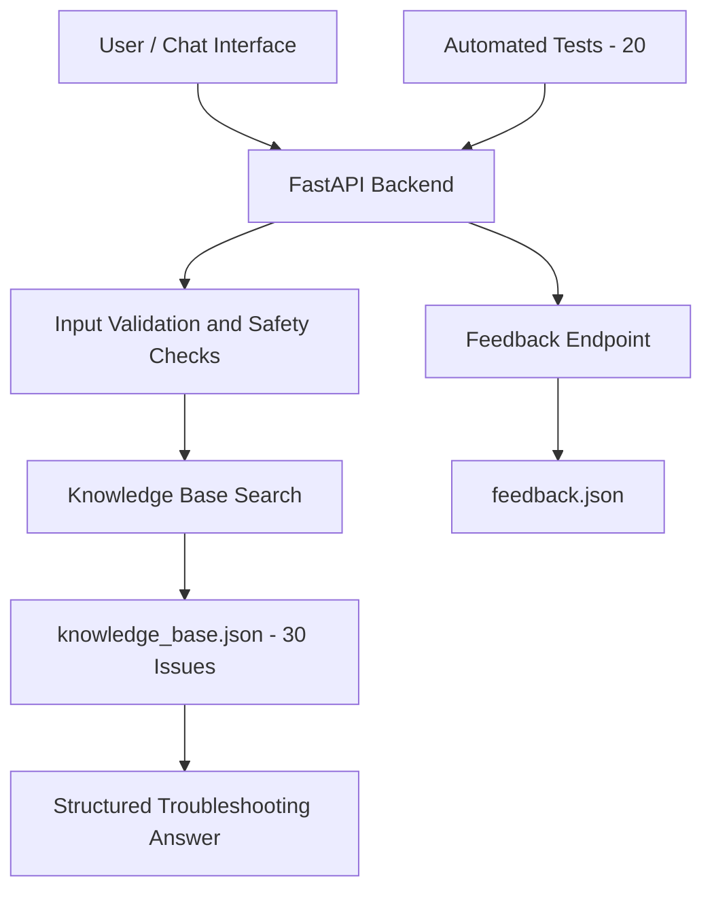

# DevOps Support Chatbot — Architecture

## Components

- **FastAPI Backend:** Handles chat and feedback requests.
- **Knowledge Base:** Contains 30 common DevOps issues, their likely causes, fixes, tips, and sources.
- **Search:** Matches user queries with relevant knowledge-base issues.
- **Feedback:** Stores helpful or unhelpful ratings.
- **Automated Tests:** Checks API endpoints and expected chatbot behavior.

## Response Format

Problem → Likely Cause → Fix Steps → Extra Tips
